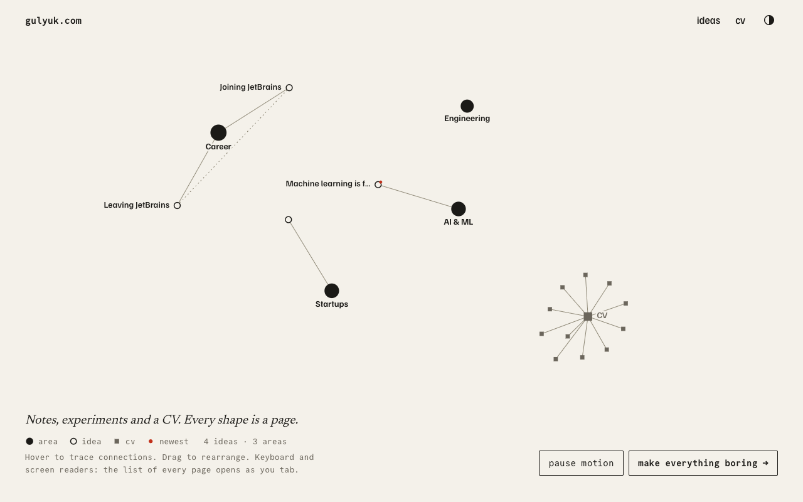

<p align="center">
  <picture>
    <source media="(prefers-color-scheme: dark)" srcset="brand/mark-dark.svg">
    
  </picture>
</p>

<h1 align="center">gulyuk.com</h1>

<p align="center">
  A personal site: a CV, notes, interactive explainers about machine learning, and a graph that connects them.<br>
  <a href="https://gulyuk.com">gulyuk.com</a>
</p>



## What is in it

- **Ideas.** Markdown notes with a small fixed vocabulary (one area, up to three topics), a maturity level, and
  an automatically drawn share picture for every idea.
- **A graph as the home page.** Server-rendered SVG with a deterministic layout, so it is already settled when the page
  arrives. The plain list of the same pages is always there too, as the accessible and mobile version.
- **An interactive essay.** *Machine learning is function approximation*: playable figures that fit curves in the
  browser, maths rendered as MathML, and a plain-text copy served as Markdown and in `llms.txt`.
- **A CV** kept in one YAML file, rendered as a page with a print stylesheet and a downloadable PDF.
- **Made to be found and shared.** Per-idea share cards, JSON-LD, sitemap, RSS, `llms.txt`, and a Markdown copy of
  every page.
- **No cookies.** Optional self-hosted, cookieless visit statistics that respect Global Privacy Control, Do Not Track
  and a footer opt-out.

Built with Nuxt 4 and Nuxt Content 3, generated to static files, and served by Caddy on Railway behind Cloudflare.

## Quick start

Needs Node 22.22+ (or 24.15+) and [pnpm](https://pnpm.io).

```bash
pnpm install
pnpm dev            # http://localhost:3000
```

| Command | What it does |
|---|---|
| `pnpm dev` | Dev server (builds the essay bundle first) |
| `pnpm generate` | Static build into `.output/public` |
| `pnpm test` | Unit tests (Vitest): graph, content schema, taxonomy, analytics logic |
| `pnpm test:essay` | The essay's own tests (`node:test`) |
| `pnpm generate:test && pnpm test:e2e` | Playwright and axe against the static build, using your installed Chrome |
| `pnpm taxonomy` | Regenerate the vocabulary tables in [NEW-IDEA-CHECKLIST.md](NEW-IDEA-CHECKLIST.md) |
| `pnpm cv:pdf` | Rebuild the downloadable CV PDF |

## Writing content

### Add an idea

Create `content/ideas/some-slug.md`. The filename becomes the URL (`/ideas/some-slug`) and never changes.
The area and topics must come from the fixed vocabulary in `content/taxonomy.yml`: read
[NEW-IDEA-CHECKLIST.md](NEW-IDEA-CHECKLIST.md) first, and only add a topic when nothing in the list fits.

```md
---
title: What the note is called
summary: One or two sentences. Required; it feeds the list, RSS and search snippets.
tagline: One short line, 80 characters at most. Required; it is printed on the idea's share picture.
date: 2026-10-20
area: ai                    # exactly one area; it is the idea's hub on the graph
topics: [ml-fundamentals, math]   # 0 to 3 topics; tags only, never graph nodes
kind: research              # research | project | note | linkedin
maturity: seedling          # seedling | budding | evergreen
math: true                  # only if the note has equations
draft: true                 # hide it everywhere until you remove this line
---

Write markdown. Inline math is $x^2$, display math is $$ ... $$.
```

The graph, the list, topic pages, RSS, the sitemap and `llms.txt` all update on the next build, and so does the
**share picture**: a 1200x630 card with the mark, title, tagline, and kind and reading time, drawn at build time. It is
what Telegram, LinkedIn and iMessage show when the link is posted (chat apps cache previews; Telegram's
[@WebpageBot](https://t.me/WebpageBot) refreshes one). A bad frontmatter field fails the build with a message instead
of publishing a broken page.

### Embed an interactive demo

A demo is a Vue component in `app/components/content/`. A file named `MyDemo.vue` is used in Markdown as `::my-demo`
followed by `::` on its own line. Give the root element `class="breakout"` to let it run wider than the text column.
The essay is the full example: `FunctionApproximationEssay.vue`, built from `essays/function-approximation/`.

### Add a LinkedIn post

On LinkedIn open the post menu, choose "Embed this post", and copy the `src` address from the code it gives you.
Create an idea with `kind: linkedin` and `embed: <that address>`, and put it in the body with:

```md
::linkedin-embed{url="https://www.linkedin.com/embed/feed/update/urn:li:share:123" postUrl="https://www.linkedin.com/posts/..." label="26 Sep 2026"}
::
```

Nothing from LinkedIn loads until the visitor presses the button.

### Edit the CV

Everything is in `content/cv.yml`. Each `id` becomes an anchor on `/cv` and a node in the graph, and the areas listed
in an entry connect it to the matching hub.

The downloadable PDF (`public/pdf/Grigory-Gulyuk-CV.pdf`) is a **committed file**, printed from the built `/cv` page, so it
does not update by itself. **Rebuild it whenever any of these change**, and commit it with the change:

- `content/cv.yml`, or `content/taxonomy.yml` (the topic tags in the PDF link to topic pages);
- `app/pages/cv.vue` or the print styles (`@media print` in `cv.vue` and `app/assets/css/main.css`);
- the site's fonts or colours.

```bash
pnpm generate && pnpm cv:pdf && pnpm generate
```

Use a plain `pnpm generate` here, not `generate:test`. `cv:pdf` needs the Chrome installed on the machine (nothing is
downloaded), serves `.output/public` on a random local port, and prints `/cv`. Because Chrome writes each link's resolved
address into the PDF, the script rewrites every link that stays on the site to `https://gulyuk.com/...` first. The second
`generate` copies the fresh PDF into `.output/public`. `tests/unit/cv-pdf.test.ts` fails if the committed PDF still
contains a local address (`127.0.0.1`, `localhost`) or a non-HTTPS link.

## Project layout

| Path | What lives there |
|---|---|
| `app/` | Pages, components, composables and plugins (the Nuxt app) |
| `app/components/OgImage/` | The share-card template |
| `content/` | `ideas/*.md`, `cv.yml`, `taxonomy.yml` |
| `essays/function-approximation/` | Source and build of the interactive essay |
| `shared/` | Pure, unit-tested logic: graph building, analytics rules, tagline helper |
| `brand/` | The logo kit and usage rules |
| `public/` | Icons, web manifest, fonts for share images, the CV PDF |
| `scripts/` | Taxonomy table generator, CV PDF builder |
| `tests/` | Vitest unit tests and Playwright end-to-end tests |
| `Dockerfile`, `Caddyfile` | Static build and server (what Railway runs) |

## Deploying

Railway builds the `Dockerfile` (a Node stage generates the static site, a Caddy stage serves it) on every push to
`main`. DNS, Cloudflare and the `www` redirect are covered step by step in [DEPLOY.md](DEPLOY.md).

## Documentation

- [docs/design.md](docs/design.md): the design notes: concept, stack, content model, graph, visual system, sharing
- [docs/analytics.md](docs/analytics.md): visit statistics: what is counted, the events, how to switch it on
- [DEPLOY.md](DEPLOY.md): hosting on Railway behind Cloudflare
- [NEW-IDEA-CHECKLIST.md](NEW-IDEA-CHECKLIST.md): the vocabulary, and how to file a new idea
- [brand/README.md](brand/README.md): the logo, colours and rules
- [CLAUDE.md](CLAUDE.md): project context for working on the site with Claude Code
